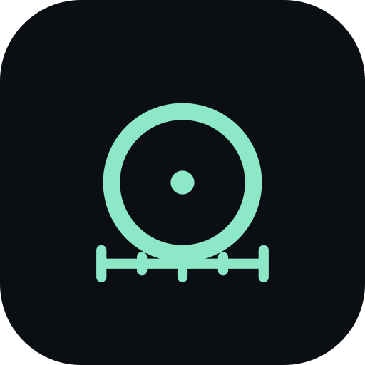
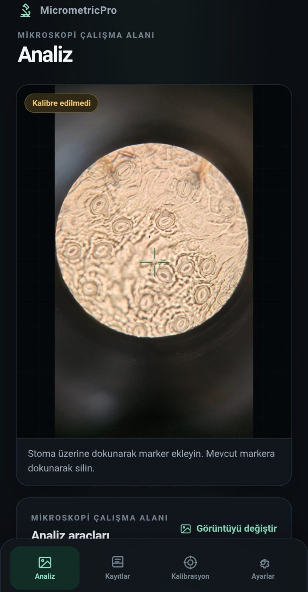
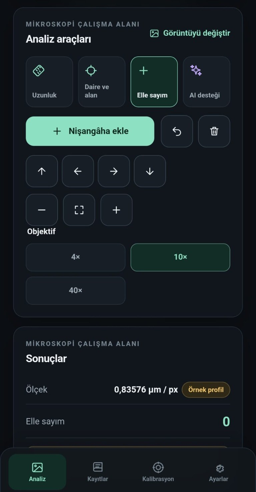
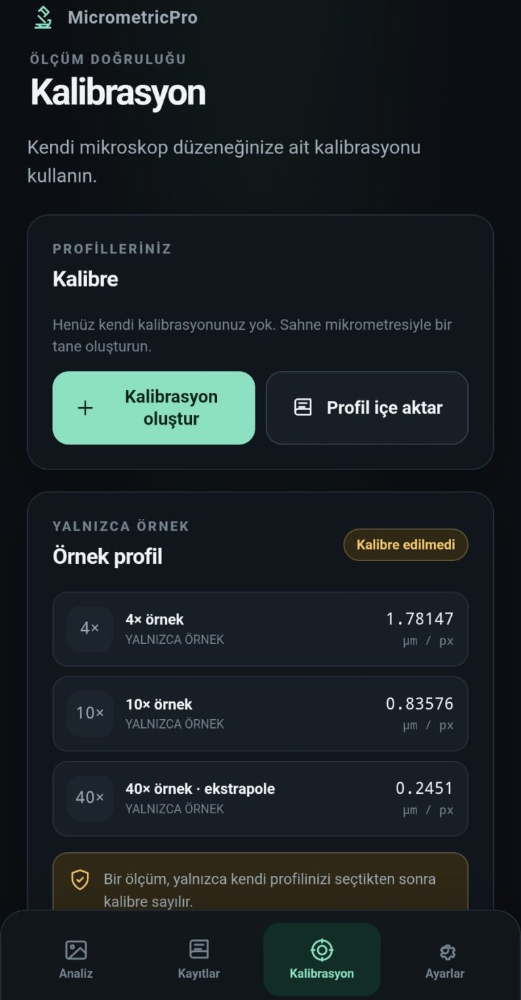
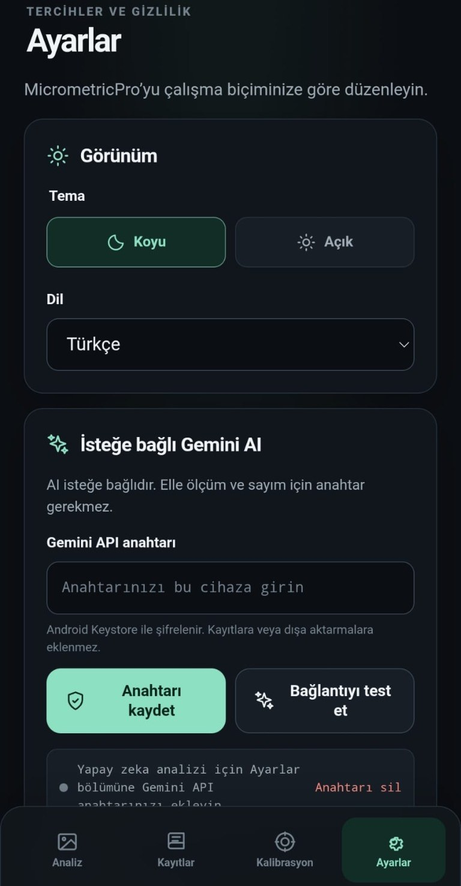
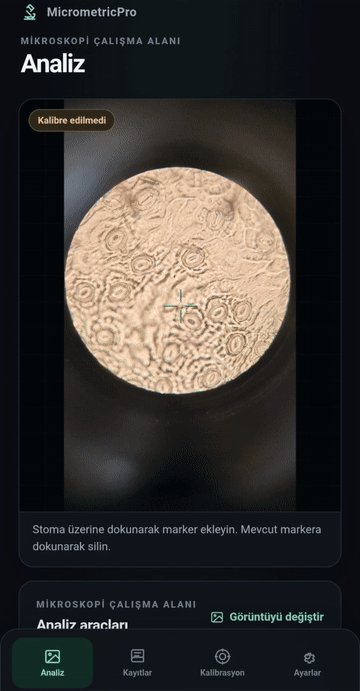

<div align="center">



# 🔬 MicrometricPro

### Calibrated microscope measurement & stomata counting — right on your phone

**Measure length, circle area and stomata density from microscope photos with your own stage-micrometer calibration. Offline-first, no account, no backend. Optional AI assist with your own Gemini key.**

[](#)
[](https://capacitorjs.com/)
[](LICENSE)
[](PRIVACY.md)

Aksu 15 Temmuz Şehitler Anadolu Lisesi öğrencileri tarafından geliştirilmiştir · Developed by students of Aksu 15 Temmuz Şehitler Anadolu Lisesi

[English](#english) · [Türkçe](#türkçe)

</div>

---

<div align="center">
  
  
  
  
</div>

<div align="center">
  
  <br />
  <b>⬇️ <a href="https://github.com/Aristotheles/micrometricpro/releases/latest">Download the APK / APK'yı indir</a></b>
</div>

---

# English

## Why MicrometricPro?

Counting stomata or measuring cells under a microscope usually means moving photos to a PC and using heavy desktop software. MicrometricPro does it on the phone that took the picture. You calibrate with **your own stage micrometer**, so every length, area and density is based on your real optical setup — not on guesses.

Everything runs locally. Your images and measurements never leave the device unless you choose to share an export.

## Features

- 📏 **Length tool** — two precise points, result in µm.
- ⭕ **Circle & area** — define the field of view with 3 edge points; get diameter (µm) and area (mm²).
- ➕ **Manual stomata counting** — tap to add or remove markers; density is computed per mm² of the circle.
- 🎯 **Pixel-precise placement** — crosshair, 1 px nudge pad, pinch zoom and pan.
- 🧪 **Calibration wizard** — photograph a stage micrometer, mark two points a known distance apart, save a profile per objective (4×, 10×, 40× …).
- ⚠️ **Honest labelling** — results are labelled **Calibrated** only when they use _your_ profile. Built-in values are an **Example** profile and are always flagged uncalibrated.
- 📦 **Profile import / export** — share calibration profiles as JSON.
- 🗂️ **Records** — save, search, rename, delete and reopen samples; the image and the calibration snapshot used are stored with each record.
- 📤 **CSV / JSON export** — CSV is UTF-8 with BOM, dot decimals and CRLF, so Excel opens it correctly; spreadsheet formula injection is neutralised.
- ✨ **Optional AI assist** — Gemini detects stomata in the circle; you review and correct every point. AI is never used for physical values.
- 🌍 **English, Türkçe, Deutsch**, dark and light themes.
- 🔒 **Private by design** — no account, no analytics, no backend, Android backup disabled, only the `INTERNET` permission.

## How it works

1. **Calibrate** (Calibrate tab) — open a photo of your stage micrometer, place point A and B on two graduation marks, enter the known distance in µm, name the profile and save. Repeat for each objective.
2. **Analyze** — open a sample photo, pick the objective, then measure length, draw the counting circle and tap stomata.
3. **(Optional) AI assist** — run Gemini on the circle, then accept, remove or add points manually.
4. **Save & export** — store the record on the device; export a CSV or JSON from the Records tab through the Android share sheet.

> The scale is computed as `µm/px = known distance ÷ pixel distance`. Length, area and density are computed deterministically in app code only.

## Optional AI (Gemini, bring your own key)

1. Create an API key in [Google AI Studio](https://aistudio.google.com/).
2. Open **Settings → Gemini API key** (or paste it during onboarding) and save it. It is encrypted with the Android Keystore.
3. Use **Test connection**, then run **AI assist** on a drawn circle. The first run asks for your consent.

What is sent: only the masked, downscaled **circular crop** and a prompt, directly from your phone to Google, with your key in a request header. Manual counts, calibration and measurements are never sent. You use your own quota and are bound by Google's terms. Remove the key any time in Settings. Details: [PRIVACY.md](PRIVACY.md).

## Install

- **Debug APK (CI):** download the `micrometricpro-debug-apk` artifact from the latest GitHub Actions run, then allow installation from unknown sources on your phone.
- **Build it yourself:** see below. Signed release builds: [RELEASE.md](RELEASE.md).

## Build from source

Requirements: Node.js 20+, JDK 21, Android SDK (platform 36).

```
git clone https://github.com/Aristotheles/micrometricpro.git
cd micrometricpro
npm install
npm run dev            # Vite dev server (browser preview)
npm run check          # formatting + source policy checks
npm run test:unit      # unit tests
npx playwright install chromium
npm run test:e2e       # end-to-end tests (mobile viewport)
npm run build          # production web build
npm run android:debug  # build a debug APK
```

The APK is written to `android/app/build/outputs/apk/debug/app-debug.apk`.

## Tech stack

Capacitor 8 · Vanilla JavaScript (ES modules) · Vite · Android Keystore secure storage · Playwright · node:test. Dependencies and licenses: [THIRD_PARTY.md](THIRD_PARTY.md).

## Limitations

- Android only (minSdk 26).
- Accuracy depends on your calibration quality and image sharpness. Always calibrate each objective with a stage micrometer.
- AI detections are suggestions; review them before trusting a count.
- Research/educational tool — not a certified measurement instrument.

## Developers

MicrometricPro was coded and published by students of Aksu 15 Temmuz Şehitler Anadolu Lisesi (Giresun, Türkiye), using AI-assisted development with GitHub Copilot. The deterministic measurement core (`src/core/`) was carried over, together with its tests, from an earlier version written by the project advisor.

---

# Türkçe

## Neden MicrometricPro?

Mikroskop altında stoma saymak veya hücre ölçmek genellikle fotoğrafları bilgisayara taşıyıp ağır masaüstü programlar kullanmak demektir. MicrometricPro bunu fotoğrafı çeken telefonda yapar. **Kendi sahne mikrometrenizle** kalibre edersiniz; böylece her uzunluk, alan ve yoğunluk tahmine değil gerçek optik düzeneğinize dayanır.

Her şey cihazda çalışır. Görüntüleriniz ve ölçümleriniz, bir dışa aktarmayı siz paylaşmadıkça cihazdan çıkmaz.

## Özellikler

- 📏 **Uzunluk aracı** — iki hassas nokta, sonuç µm cinsinden.
- ⭕ **Daire ve alan** — görüş alanını 3 kenar noktasıyla belirleyin; çap (µm) ve alan (mm²) hesaplanır.
- ➕ **Elle stoma sayımı** — dokunarak marker ekleyin veya silin; yoğunluk dairenin mm² başına hesaplanır.
- 🎯 **Piksel hassasiyetinde yerleştirme** — nişangâh, 1 px ince ayar tuşları, iki parmakla yakınlaştırma ve kaydırma.
- 🧪 **Kalibrasyon sihirbazı** — sahne mikrometresini çekin, bilinen mesafedeki iki noktayı işaretleyin, her objektif için (4×, 10×, 40× …) profil kaydedin.
- ⚠️ **Dürüst etiketleme** — sonuç yalnızca _sizin_ profilinizi kullandığında **Kalibre** sayılır. Dahili değerler **Örnek** profildir ve her zaman "Kalibre edilmedi" uyarısı taşır.
- 📦 **Profil içe / dışa aktarma** — kalibrasyon profillerini JSON olarak paylaşın.
- 🗂️ **Kayıtlar** — örnekleri kaydedin, arayın, yeniden adlandırın, silin ve tekrar açın; görüntü ve kullanılan kalibrasyonun kopyası kayıtla birlikte saklanır.
- 📤 **CSV / JSON dışa aktarma** — CSV, Excel'de doğru açılsın diye UTF-8 BOM, nokta ondalık ve CRLF kullanır; tablo formülü enjeksiyonu engellenir.
- ✨ **İsteğe bağlı AI desteği** — Gemini daire içindeki stomaları bulur; her noktayı siz gözden geçirip düzeltirsiniz. Fiziksel değerler için AI asla kullanılmaz.
- 🌍 **English, Türkçe, Deutsch**, koyu ve açık tema.
- 🔒 **Tasarımdan gizli** — hesap, analitik ve sunucu yok; Android yedeği kapalı; yalnızca `INTERNET` izni.

## Nasıl çalışır?

1. **Kalibre edin** (Kalibrasyon sekmesi) — sahne mikrometresinin fotoğrafını açın, iki çizgiye A ve B noktalarını koyun, bilinen mesafeyi µm olarak girin, profile ad verip kaydedin. Her objektif için tekrarlayın.
2. **Analiz edin** — örnek fotoğrafı açın, objektifi seçin; uzunluk ölçün, sayım dairesini çizin ve stomalara dokunun.
3. **(İsteğe bağlı) AI desteği** — daire üzerinde Gemini'yi çalıştırın; noktaları kabul edin, silin veya elle ekleyin.
4. **Kaydedin ve dışa aktarın** — kaydı cihazda saklayın; Kayıtlar sekmesinden Android paylaşım menüsüyle CSV veya JSON dışa aktarın.

> Ölçek `µm/px = bilinen mesafe ÷ piksel mesafesi` olarak hesaplanır. Uzunluk, alan ve yoğunluk yalnızca uygulama kodunda, deterministik olarak hesaplanır.

## İsteğe bağlı AI (Gemini, kendi anahtarınızla)

1. [Google AI Studio](https://aistudio.google.com/)'da bir API anahtarı oluşturun.
2. **Ayarlar → Gemini API anahtarı** bölümüne (veya ilk kurulumda) yapıştırıp kaydedin. Anahtar Android Keystore ile şifrelenir.
3. **Bağlantıyı test et**'i kullanın, sonra çizdiğiniz daire üzerinde **AI desteği**'ni çalıştırın. İlk çalıştırmada onayınız istenir.

Gönderilen: yalnızca maskelenmiş, küçültülmüş **dairesel kırpma** ve bir istem; doğrudan telefonunuzdan Google'a, anahtarınız istek başlığında olacak şekilde. Elle sayımlar, kalibrasyon ve ölçümler asla gönderilmez. Kendi kotanızı kullanırsınız ve Google'ın şartlarına tabisiniz. Anahtarı istediğiniz an Ayarlar'dan silebilirsiniz. Ayrıntılar: [PRIVACY.md](PRIVACY.md).

## Kurulum

- **Debug APK (CI):** en son GitHub Actions çalıştırmasındaki `micrometricpro-debug-apk` artifact'ını indirin; telefonda bilinmeyen kaynaklardan yüklemeye izin verin.
- **Kendiniz derleyin:** aşağıya bakın. İmzalı sürüm: [RELEASE.md](RELEASE.md).

## Kaynaktan derleme

Gereksinimler: Node.js 20+, JDK 21, Android SDK (platform 36).

```
git clone https://github.com/Aristotheles/micrometricpro.git
cd micrometricpro
npm install
npm run dev            # Vite geliştirme sunucusu (tarayıcı önizleme)
npm run check          # biçim + kaynak politikası kontrolleri
npm run test:unit      # birim testleri
npx playwright install chromium
npm run test:e2e       # uçtan uca testler (mobil görünüm)
npm run build          # üretim web derlemesi
npm run android:debug  # debug APK derle
```

APK şuraya yazılır: `android/app/build/outputs/apk/debug/app-debug.apk`.

## Teknoloji

Capacitor 8 · Vanilla JavaScript (ES modülleri) · Vite · Android Keystore güvenli depolama · Playwright · node:test. Bağımlılıklar ve lisanslar: [THIRD_PARTY.md](THIRD_PARTY.md).

## Sınırlamalar

- Yalnızca Android (minSdk 26).
- Doğruluk, kalibrasyon kalitesine ve görüntü netliğine bağlıdır. Her objektifi sahne mikrometresiyle kalibre edin.
- AI tespitleri öneridir; bir sayıya güvenmeden önce gözden geçirin.
- Araştırma/eğitim aracıdır; sertifikalı bir ölçüm cihazı değildir.

## Geliştirenler

MicrometricPro, Aksu 15 Temmuz Şehitler Anadolu Lisesi (Giresun) öğrencileri tarafından GitHub Copilot ile yapay zekâ destekli olarak kodlanmış ve yayımlanmıştır. Deterministik ölçüm çekirdeği (`src/core/`), testleriyle birlikte, proje danışmanının yazdığı önceki sürümden alınmıştır.

---

<div align="center">

MIT © 2026 Aksu 15 Temmuz Şehitler Anadolu Lisesi öğrencileri

</div>
